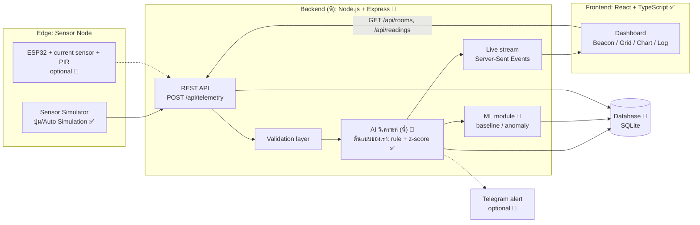
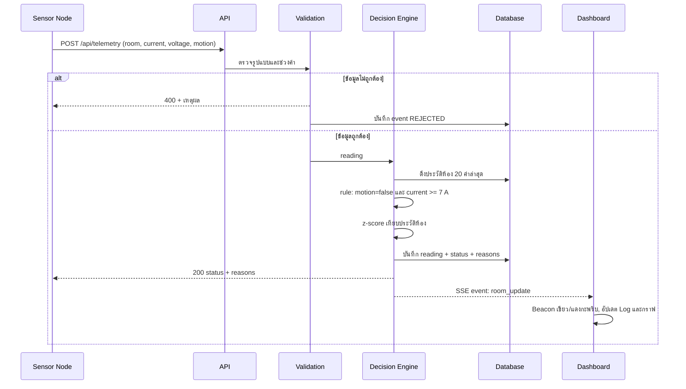
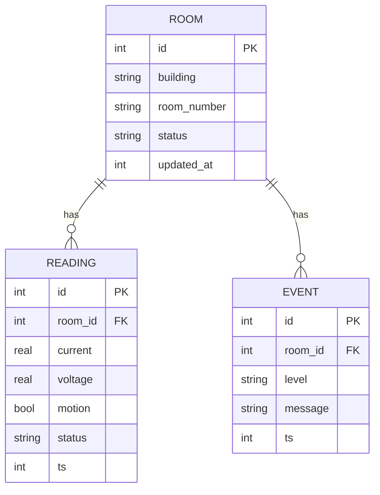

# KMITL Smart Grid & AI Energy Guardian — Architecture

เอกสารนี้อธิบายภาพรวมระบบ, workflow การทำงาน และขอบเขตงาน (scope) ของ Backend และ AI/ML
สถานะ: **Draft v1** · ส่วนที่ทำแล้วมีเครื่องหมาย ✅ ส่วนที่วางแผนไว้มี 🔲

---

## 1. ปัญหาและเป้าหมาย

ห้องเรียนมักเปิดไฟ/แอร์ทิ้งไว้เมื่อไม่มีคนอยู่ ระบบนี้ **ตรวจจับ Energy Waste จากค่ากระแสไฟและสัญญาณการมีคนอยู่ แล้วแจ้งเตือนแบบ real-time** พร้อมประเมินค่าไฟที่สูญเสีย

เป้าหมายหลัก
1. ตรวจจับความสิ้นเปลืองได้ถูกต้องและ **อธิบายเหตุผลได้**
2. แสดงผลบน Engineering Dashboard แบบ real-time
3. ทนต่อข้อมูลผิดพลาด (fault tolerant) — ระบบไม่ล่มเมื่อข้อมูลเสีย
4. ตรวจสอบคุณภาพโค้ดได้ (test + CI + SonarCloud)

---

## 1.1 การแบ่งความรับผิดชอบ

| ส่วน | เจ้าของ | หน้าที่ |
|---|---|---|
| Frontend Dashboard (React) | nackjub | แสดง Beacon / Grid / Chart / Log |
| IoT Simulator (สคริปต์ + ปุ่มในเว็บ) | nackjub | จำลองบอร์ด IoT ยิงค่ากระแส/แรงดัน/คนอยู่ ไปที่ API |
| Backend API + Database | พี่ (mentor) | รับ telemetry เก็บข้อมูล ส่งผลกลับ |
| AI วิเคราะห์ Energy Waste | พี่ (mentor) | รับ telemetry แล้วตัดสินว่าห้องไหนเปลือง |
| **API Contract** | ตกลงร่วมกัน | จุดเชื่อมต่อ ทำให้ทั้งสองฝั่งทำงานคู่ขนานได้ |
| CI / SonarCloud / Deploy | ตกลงร่วมกัน | Deploy ให้คนทั่วไปเข้าใช้ได้ |

> ตารางนี้อิงจากบทสนทนาในทีม ควรยืนยันกับพี่อีกครั้ง

---

## 2. System Architecture

**สถานะปัจจุบัน:** Frontend + Decision Engine ทำงานครบในโหมด Local (ไม่มี backend) — engine เป็น pure function (`src/engine/energy.ts`) จึงย้ายไปรันฝั่ง server ได้โดยไม่ต้องเขียนใหม่

---

## 3. Workflow การทำงาน (1 รอบการส่งสัญญาณ)

---

## 4. Decision Engine และ AI/ML Scope

> ส่วนนี้พี่เป็นเจ้าของ ตัว L1–L2 ในโปรเจกต์ฝั่งเราเป็น **ต้นแบบอ้างอิงและ fallback ตอน API ล่ม** ใช้เป็นข้อเสนอให้พี่ว่าควรตรวจอะไรบ้าง

เราแบ่งเป็นระดับ เพื่อไม่ให้อ้างเกินสิ่งที่ทำจริง

| ระดับ | วิธี | สถานะ | หมายเหตุ |
|---|---|---|---|
| L1 | **Rule-based**: ไม่มีคน และกระแส ≥ 7 A | ✅ | อธิบายได้ 100% |
| L2 | **Statistical anomaly**: z-score เทียบประวัติของห้อง (≥ 5 ค่า, z > 2.5) | ✅ | ไม่ต้องฝึกโมเดล |
| L3 | **Baseline ตามช่วงเวลา**: ค่าเฉลี่ยกระแสต่อห้องต่อชั่วโมงของวัน (EWMA) เพื่อแยก "ใช้ปกติ" ออกจาก "ผิดปกติ" | 🔲 | ใช้ข้อมูลที่สะสมใน DB |
| L4 | **ML (optional)**: Isolation Forest หรือโมเดลพยากรณ์โหลด | 🔲 | ทำเมื่อ L1–L3 เสร็จและมีข้อมูลพอ |

**ข้อตกลงเรื่องความซื่อตรงของข้อมูล**
- ข้อมูลที่ใช้ฝึก/ทดสอบเป็น **ข้อมูลจำลอง (synthetic)** จากสถานการณ์ในหน้าเว็บ ไม่ใช่ข้อมูลจริงของ สจล. ต้องระบุในรายงาน
- ถ้าไม่มีเวลาทำ L4 ให้เรียกระบบว่า *rule-based + statistical anomaly detection* ไม่เรียกว่า machine learning

**การวัดผล (Evaluation)**
- สร้างชุดสถานการณ์จำลองที่รู้เฉลยล่วงหน้า (เช่น 500 รายการ: ปกติ / เปิดไฟทิ้ง / ค่ากระโดดผิดปกติ)
- รายงาน Precision, Recall, F1 ของแต่ละระดับ เปรียบเทียบ L1 vs L1+L2 vs L3 (ตารางเดียวใช้เล่าในพอร์ตได้)

**ตัวเลขประหยัดพลังงาน**
- P = V × I → kWh/เดือน = P × ชั่วโมงที่ว่าง → บาท และ kg CO₂
- ค่าสมมติ (ปรับได้ใน `src/engine/energy.ts`): ค่าไฟ 4.2 บาท/หน่วย, 0.5 kgCO₂/kWh, ว่าง 14 ชม./วัน × 22 วัน
- ต้องแทนด้วยตัวเลขจริงของ สจล. ถ้าหาได้

---

## 5. Backend Scope

> พี่เป็นเจ้าของ ฝั่งเราเขียน API Contract + mock API เพื่อพัฒนา Dashboard ไปพร้อมกัน

**อยู่ใน scope**
- REST API + validation + บันทึกลง DB
- เรียก Decision Engine ฝั่ง server (ใช้โค้ดเดียวกับ frontend)
- ส่งผลให้ Dashboard: แบบง่ายคือ Dashboard เรียก `GET /api/rooms` ทุก 2 วินาที (polling) หรือแบบ real-time ด้วย SSE ตกลงกับพี่
- Test: unit (engine) + integration (API) รันใน CI

**ไม่อยู่ใน scope (ระยะแรก)**
- ระบบล็อกอิน/สิทธิ์ผู้ใช้
- ฐานข้อมูลบนคลาวด์ / multi-server
- การควบคุมอุปกรณ์จริง (สั่งตัดไฟ)

### API Contract

| Method | Path | หน้าที่ |
|---|---|---|
| POST | `/api/telemetry` | รับค่าจากเซนเซอร์ คืนผลวิเคราะห์ |
| GET | `/api/rooms` | สถานะล่าสุดของทุกห้อง |
| GET | `/api/readings?roomId=&limit=` | ประวัติค่าสำหรับกราฟ |
| GET | `/api/events` | (optional) SSE stream อัปเดตแบบ real-time |
| GET | `/api/health` | ตรวจสถานะเซิร์ฟเวอร์ |

รายละเอียด request/response ทั้งหมดอยู่ใน [API_CONTRACT.md](API_CONTRACT.md) (mock API ทำตามสัญญานี้แล้ว ✅)

### Data Model

---

## 6. Fault Tolerance

| สถานการณ์ | พฤติกรรมของระบบ |
|---|---|
| ค่ากระแส/แรงดันนอกช่วง (ติดลบ, NaN, > 100 A, > 500 V) | ปฏิเสธ ตอบ 400 บันทึก event ระบบไม่ล่ม |
| หมายเลขห้องว่างหรือมีอักขระต้องห้าม | ปฏิเสธและแจ้งผู้ใช้ |
| ประวัติห้องน้อยกว่า 5 ค่า | ข้าม z-score ใช้ rule อย่างเดียว |
| Component ฝั่ง UI เกิด error | Error Boundary แสดงปุ่ม RECOVER ✅ |
| Storage ฝั่งเบราว์เซอร์เต็ม/ถูกบล็อก | ทำงานต่อในหน่วยความจำ ✅ |
| Backend ไม่ตอบ 🔲 | Dashboard แสดงสถานะ OFFLINE และกลับไปโหมด Local |

---

## 7. คุณภาพโค้ด

- TypeScript (strict) + ESLint ✅
- Unit test ของ Decision Engine 8 ข้อ (Vitest) ✅
- GitHub Actions: typecheck → lint → test → build ✅
- SonarCloud: ไฟล์ตั้งค่าพร้อม (`sonar-project.properties`) รอเชื่อมบัญชี 🔲

---

## 8. Milestones

| M | งาน | ผลลัพธ์ที่ตรวจได้ |
|---|---|---|
| M0 ✅ | Frontend + Engine + Auto Simulation + CI | รันบน localhost ได้ |
| M0.5 ✅ | ตกลง API Contract กับพี่ + nackjub ทำ mock API + สคริปต์จำลอง IoT (`npm run mock-api`, `npm run simulate`) | ทั้งสองฝั่งใช้สัญญาเดียวกัน |
| M1 | (พี่) Backend Express + validation + SQLite + API ตาม contract | integration test ผ่านใน CI |
| M2 | (nackjub) ต่อ Dashboard เข้ากับ API + SSE + fallback ออฟไลน์ | เห็นข้อมูลสดข้ามเครื่อง |
| M3 | (พี่) L3 baseline ตามชั่วโมง + ชุดประเมินผล Precision/Recall | ตารางเปรียบเทียบ L1/L2/L3 |
| M4 | (optional) L4 ML, Telegram alert, ESP32 ต้นแบบ | เดโมแยกต่างหาก |
| M5 | รายงาน/พอร์ต + คลิปสาธิต | เอกสารส่งกรรมการ |

## 9. ประเด็นที่ต้องตัดสินใจ (Open Decisions)

ถามพี่
1. ยืนยันการแบ่งงานในหัวข้อ 1.1 และให้พี่ดู/แก้ API Contract ในหัวข้อ 5
2. ให้ Dashboard ใช้ polling หรือ SSE
3. Backend ใช้ Node.js + ฐานข้อมูลอะไร และ AI ของพี่ใช้วิธีอะไร (rule, สถิติ หรือ ML) เพื่อเขียนในรายงานให้ตรงกัน
4. Deploy ที่ไหน (ฝั่งหน้าเว็บ เช่น Vercel/Netlify, ฝั่ง API ต้องเป็น HTTPS และเปิด CORS ให้โดเมนหน้าเว็บ)
5. จะมีฮาร์ดแวร์จริง (ESP32) หรือใช้ตัวจำลองทั้งหมด

## 10. ข้อจำกัด

- เซนเซอร์เป็นการจำลอง ตัวเลขเงินและคาร์บอนอิงข้อสมมติ ไม่ใช่ข้อมูลวัดจริง
- เกณฑ์ 7 A เป็นค่าตั้งต้น ควรปรับตามขนาดห้องและอุปกรณ์จริง

## 11. Deploy

- Frontend: `npm run build` แล้วอัปโฟลเดอร์ `dist/` ขึ้น Vercel/Netlify/GitHub Pages
- ตั้ง `VITE_API_URL` ตอน build ชี้ไปที่ API จริง (ต้อง HTTPS ถ้าเว็บเป็น HTTPS)
- API ต้องเปิด CORS ให้โดเมนของเว็บ
- ห้าม commit ไฟล์ `.env` (อยู่ใน `.gitignore` แล้ว)
