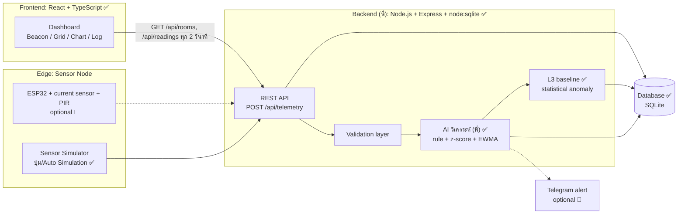
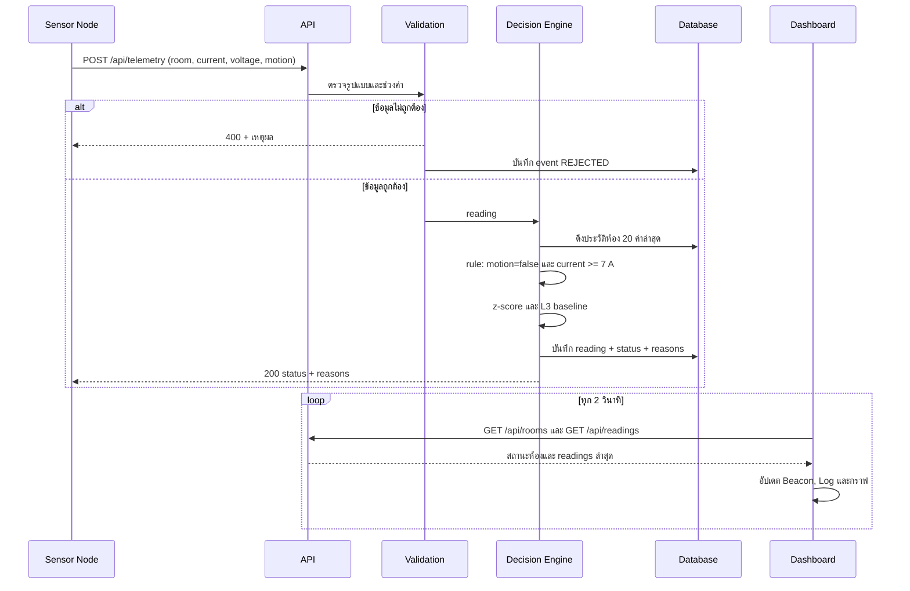
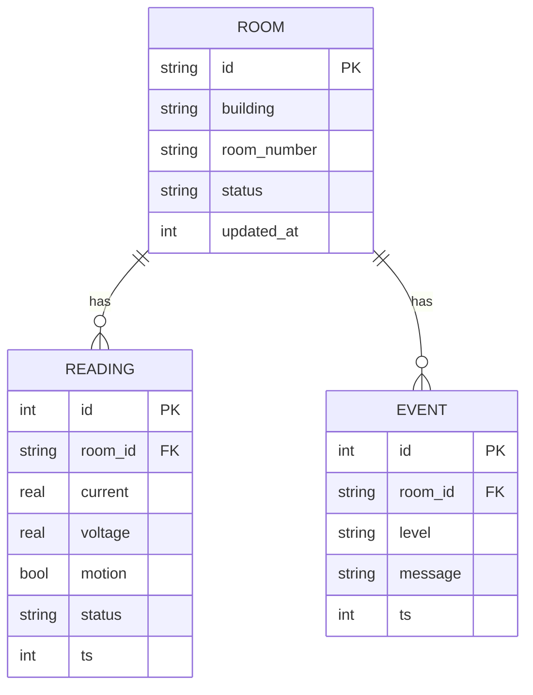

# KMITL Smart Grid & AI Energy Guardian — Architecture

เอกสารนี้อธิบายภาพรวมระบบ, workflow การทำงาน และขอบเขตงาน (scope) ของ Backend และ AI/ML
สถานะ: **Draft v1** · ส่วนที่ทำแล้วมีเครื่องหมาย ✅ ส่วนที่วางแผนไว้มี 🔲

---

## 1. ปัญหาและเป้าหมาย

ห้องเรียนมักเปิดไฟ/แอร์ทิ้งไว้เมื่อไม่มีคนอยู่ ระบบนี้ **ตรวจจับ Energy Waste จากค่ากระแสไฟและสัญญาณการมีคนอยู่ แล้วแจ้งเตือนแบบ real-time** พร้อมประเมินค่าไฟที่สูญเสีย

เป้าหมายหลัก
1. ตรวจจับความสิ้นเปลืองได้ถูกต้องและ **อธิบายเหตุผลได้**
2. แสดงผลบน Engineering Dashboard แบบ real-time
3. ทนต่อข้อมูลผิดพลาด (fault tolerant) — ระบบไม่ล่มเมื่อข้อมูลเสีย
4. ตรวจสอบคุณภาพโค้ดได้ (test + CI + SonarCloud)

---

## 1.1 การแบ่งความรับผิดชอบ

| ส่วน | เจ้าของ | หน้าที่ |
|---|---|---|
| Frontend Dashboard (React) | nackjub | แสดง Beacon / Grid / Chart / Log |
| IoT Simulator (สคริปต์ + ปุ่มในเว็บ) | nackjub | จำลองบอร์ด IoT ยิงค่ากระแส/แรงดัน/คนอยู่ ไปที่ API |
| Backend API + Database | พี่ (mentor) | รับ telemetry เก็บข้อมูล ส่งผลกลับ |
| AI วิเคราะห์ Energy Waste | พี่ (mentor) | รับ telemetry แล้วตัดสินว่าห้องไหนเปลือง |
| **API Contract** | ตกลงร่วมกัน | จุดเชื่อมต่อ ทำให้ทั้งสองฝั่งทำงานคู่ขนานได้ |
| CI / SonarCloud / Deploy | ตกลงร่วมกัน | Deploy ให้คนทั่วไปเข้าใช้ได้ |

> ตารางนี้อิงจากบทสนทนาในทีม ควรยืนยันกับพี่อีกครั้ง

---

## 2. System Architecture



**สถานะปัจจุบัน:** Frontend + Decision Engine ทำงานในโหมด Local และมี backend จริงตามสัญญาแล้ว — engine เป็น pure function (`src/engine/energy.ts`) ซึ่ง server import มาใช้ร่วมกัน

---

## 3. Workflow การทำงาน (1 รอบการส่งสัญญาณ)



---

## 4. Decision Engine และ AI/ML Scope

> ส่วนนี้เป็นความรับผิดชอบของ backend seat: server ใช้ engine ร่วมกับ frontend และเพิ่ม L3 baseline; เมื่อ API ล่ม frontend ใช้ local engine เป็น fallback

เราแบ่งเป็นระดับ เพื่อไม่ให้อ้างเกินสิ่งที่ทำจริง

| ระดับ | วิธี | สถานะ | หมายเหตุ |
|---|---|---|---|
| L1 | **Rule-based**: ไม่มีคน และกระแส ≥ 7 A | ✅ | อธิบายได้ 100% |
| L2 | **Statistical anomaly**: z-score เทียบประวัติของห้อง (≥ 5 ค่า, z > 2.5) | ✅ | ไม่ต้องฝึกโมเดล |
| L3 | **Baseline ตามช่วงเวลา**: EWMA แยกตามห้องและชั่วโมงของสัปดาห์ | ✅ | ประเมินจาก readings ใน SQLite; ประเมินเฉพาะข้อมูลปกติเพื่อไม่ให้ baseline เรียนรู้ค่าที่สิ้นเปลือง |
| L4 | **ML (optional)**: Isolation Forest หรือโมเดลพยากรณ์โหลด | 🔲 | ทำเมื่อ L1–L3 เสร็จและมีข้อมูลพอ |

**ข้อตกลงเรื่องความซื่อตรงของข้อมูล**
- ข้อมูลที่ใช้ฝึก/ทดสอบเป็น **ข้อมูลจำลอง (synthetic)** จากสถานการณ์ในหน้าเว็บ ไม่ใช่ข้อมูลจริงของ สจล. ต้องระบุในรายงาน
- ถ้าไม่มีเวลาทำ L4 ให้เรียกระบบว่า *rule-based + statistical anomaly detection* ไม่เรียกว่า machine learning

**การวัดผล (Evaluation)**
- สร้างชุดสถานการณ์จำลองที่รู้เฉลยล่วงหน้า (เช่น 500 รายการ: ปกติ / เปิดไฟทิ้ง / ค่ากระโดดผิดปกติ)
- รายงาน Precision, Recall, F1 ของแต่ละระดับ เปรียบเทียบ L1 vs L1+L2 vs L3 (ตารางเดียวใช้เล่าในพอร์ตได้)

**ตัวเลขประหยัดพลังงาน**
- P = V × I → kWh/เดือน = P × ชั่วโมงที่ว่าง → บาท และ kg CO₂
- ค่าสมมติ (ปรับได้ใน `src/engine/energy.ts`): ค่าไฟ 4.2 บาท/หน่วย, 0.5 kgCO₂/kWh, ว่าง 14 ชม./วัน × 22 วัน
- ต้องแทนด้วยตัวเลขจริงของ สจล. ถ้าหาได้

---

## 5. Backend Scope

> พี่เป็นเจ้าของ ฝั่งเราเขียน API Contract + mock API เพื่อพัฒนา Dashboard ไปพร้อมกัน

**อยู่ใน scope**
- REST API + validation + บันทึกลง SQLite ด้วย `node:sqlite` (ต้องใช้ Node.js ≥ 22.5; แสดง `ExperimentalWarning` ตอนรันเทสต์)
- เรียก Decision Engine ฝั่ง server โดยใช้โค้ดเดียวกับ frontend
- v1 ใช้ polling ผ่าน `GET /api/rooms` และ `GET /api/readings` ทุก 2 วินาที; SSE เป็น endpoint เสริมที่ต้องตกลงก่อนเพิ่ม
- Unit tests ของ engine และ integration tests ของ API ต้องรันใน CI

**ไม่อยู่ใน scope (ระยะแรก)**
- ระบบล็อกอิน/สิทธิ์ผู้ใช้
- ฐานข้อมูลบนคลาวด์ / multi-server
- การควบคุมอุปกรณ์จริง (สั่งตัดไฟ)

### API Contract

| Method | Path | หน้าที่ |
|---|---|---|
| POST | `/api/telemetry` | รับค่าจากเซนเซอร์ คืนผลวิเคราะห์ |
| GET | `/api/rooms` | สถานะล่าสุดของทุกห้อง |
| GET | `/api/readings?roomId=&limit=` | ประวัติค่าสำหรับกราฟ |
| GET | `/api/events` | (optional) SSE stream อัปเดตแบบ real-time |
| GET | `/api/health` | ตรวจสถานะเซิร์ฟเวอร์ |

รายละเอียด request/response ทั้งหมดอยู่ใน [API_CONTRACT.md](API_CONTRACT.md) (mock API ทำตามสัญญานี้แล้ว ✅)

### Data Model



---

## 6. Fault Tolerance

| สถานการณ์ | พฤติกรรมของระบบ |
|---|---|
| ค่ากระแส/แรงดันนอกช่วง (ติดลบ, NaN, > 100 A, > 500 V) | ปฏิเสธ ตอบ 400 บันทึก event ระบบไม่ล่ม |
| หมายเลขห้องว่างหรือมีอักขระต้องห้าม | ปฏิเสธและแจ้งผู้ใช้ |
| ประวัติห้องน้อยกว่า 5 ค่า | ข้าม z-score ใช้ rule อย่างเดียว |
| Component ฝั่ง UI เกิด error | Error Boundary แสดงปุ่ม RECOVER ✅ |
| Storage ฝั่งเบราว์เซอร์เต็ม/ถูกบล็อก | ทำงานต่อในหน่วยความจำ ✅ |
| API ไม่ตอบ ✅ | Dashboard แสดงสถานะ OFFLINE และกลับไปโหมด Local |

---

## 7. คุณภาพโค้ด

- TypeScript (strict) + ESLint ✅
- Unit test ของ Decision Engine 8 ข้อ (Vitest) ✅
- GitHub Actions: typecheck → lint → test → build ✅
- SonarCloud: ไฟล์ตั้งค่าพร้อม (`sonar-project.properties`) รอเชื่อมบัญชี 🔲

---

## 8. Milestones และ Definition of Done (DoD)

ใช้เอกสารนี้เป็นแหล่งอ้างอิงหลักเพียงฉบับเดียวสำหรับ architecture และ DoD สถานะ “ทำ implementation แล้ว” ไม่เท่ากับ “ส่งมอบแล้ว”: ต้องผ่าน DoD และมีผลตรวจสอบก่อนปิด milestone

### สถานะย่อ

| M | งาน | สถานะ |
|---|---|---|
| M0 ✅ | Frontend + Engine + Auto Simulation + CI | ส่งมอบแล้ว |
| M0.5 ✅ | API Contract, mock API และสคริปต์จำลอง IoT | ส่งมอบแล้ว |
| M1 | Backend Express + validation + SQLite + API | Acceptance/integration และ local gate ผ่านจาก `c1c7a89`; DoD ยังไม่ครบจนกว่า CI ของ commit ที่ส่งขึ้น branch จะผ่าน; ยังไม่ deploy |
| M2 | เชื่อม Dashboard กับ API และ fallback ออฟไลน์ (nackjub) | งานของ nackjub |
| M3 ✅ | L3 baseline และชุดประเมินผล | ผ่าน DoD ใน local verification จาก commit `c1c7a89`; ทดสอบรายงานซ้ำและ replay ตามเวลาแล้ว |
| M4 (ทางเลือก) | L4, Telegram alert, ESP32 | ยังไม่ทำ |
| M5 | รายงาน/พอร์ตและคลิปสาธิต | ยังไม่ทำ |

### M1 — Backend API

**Definition of Done**

- API จริงทำตาม `project/API_CONTRACT.md`; `project/server/api.test.ts` เรียก contract suite เดียวกันกับทั้ง Express จริงและ mock โดยไม่แก้ `project/API_CONTRACT.md`
- Validation ปฏิเสธข้อมูลผิด บันทึก event พร้อมเหตุผลใน SQLite และ API ยังทำงานต่อได้; `app.test.ts` ตรวจเหตุผลในตาราง `events` และยืนยันว่าไม่มี reading ผิดถูกบันทึก
- SQL ใช้ prepared statements เท่านั้น; `readings` เป็น append-only และไม่มีเส้นทางแก้ไขหรือลบ
- `npm ci`, typecheck, lint, test และ build ผ่านจาก clean verification copy ที่สร้างจาก commit ที่ตรวจ; สถานะ CI ของ commit นี้ยังไม่ได้ตรวจ
- ไม่ commit `.env` หรือ `project/dist/`

### M3 — L3 และการประเมินผล

**Definition of Done**

- L3 ใช้ EWMA แยกตามห้องและชั่วโมงของสัปดาห์ โดยไม่เรียนรู้จาก readings ที่ตรวจว่าเป็นการสิ้นเปลือง
- `npm run evaluate` สร้างผลซ้ำได้จากข้อมูลสังเคราะห์ตามลำดับเวลา โดยไม่ใช้ข้อมูลอนาคต
- รายงาน Precision, Recall, F1, ผลแยกประเภท และจำนวน readings ที่ L3 ประเมินหรือข้าม พร้อมระบุข้อจำกัดและสมมติฐาน

ผลที่มีใน branch ปัจจุบัน (4 สัปดาห์, 6 ห้อง, 16,128 readings, seed 42): L1 ได้ Precision/Recall/F1 = 100.0%/53.5%/69.7%; L1+L2 = 90.1%/66.9%/76.8%; L1+L2+L3 = 90.5%/74.5%/81.7%. L3 ประเมิน 10,660 readings, ข้ามเพราะประวัติน้อย 5,444 readings และข้ามเพราะ baseline เรียบเกินไป 24 readings เลือก `BASELINE_K=6` จากการ sweep: Recall คงที่ 74.5% ระหว่าง k=3–6 ขณะที่ Precision เพิ่มจาก 75.2% เป็น 90.5%; ผลยังคงเหมาะสมบน seed 42, 7, 99 และ 2026 ดูรายงานเต็มที่ [EVALUATION.md](EVALUATION.md)

### M2, M4 และ M5

- **M2:** Dashboard อ่านข้อมูลจาก API จริง แสดง `OFFLINE` เมื่อ API ใช้งานไม่ได้ และกลับไป local mode ได้; ส่วนนี้เป็นงานของ nackjub
- **M4:** เป็นทางเลือกและต้องตกลง scope ก่อนทำ หากไม่มี L4 ห้ามเรียกระบบว่า machine learning
- **M5:** รายงานและคลิปต้องตรงกับพฤติกรรมที่ตรวจสอบได้ ระบุว่าข้อมูลเป็นข้อมูลสังเคราะห์ และระบุว่าตัวเลขค่าไฟ/คาร์บอน/ชั่วโมง idle เป็นข้อสมมติ

### สถานะการตรวจสอบล่าสุด — 2026-10-29

โค้ด `server/` และ `scripts/` ที่ตรวจอยู่ที่ commit `c1c7a8949c02edd8ea6d0fc75ce9b6c11caabeda` บน branch `docs/demo-plan`; ยังไม่ได้ push และไม่ได้ deploy

- สร้าง clean verification copy จาก commit นี้โดยไม่มี `node_modules`, `.env` หรือ `dist` ก่อนติดตั้ง; `npm ci` ผ่าน เพิ่ม 372 packages และ audit แจ้ง 14 vulnerabilities (1 low, 4 moderate, 9 high)
- จากสำเนานี้ `npm run typecheck`, `npm run lint`, `npm test` และ `npm run build` ผ่านตามลำดับ; Vitest รายงาน 5 test files / 71 tests ผ่าน และ Vite สร้าง production bundle 1,646 modules ได้
- npm 12 แจ้งว่า postinstall ของ `esbuild@0.28.2` ถูกบล็อกตาม `allowScripts`; แม้เช่นนั้น typecheck, tests และ production build ข้างต้นผ่านจริงโดยไม่ได้อนุมัติ install script เพิ่ม
- `$env:EVAL_SEED='42'; npm run evaluate` สร้างรายงาน seed 42 / 28 วัน / 6 ห้อง / 16,128 readings; metrics L1 = 100.0%/53.5%/69.7%, L1+L2 = 90.1%/66.9%/76.8%, L1+L2+L3 = 90.5%/74.5%/81.7%; TP/FP/FN/TN = 822/86/282/14,938; L3 ตัดสิน 10,660, ข้ามเพราะข้อมูลน้อย 5,444 และ baseline เรียบเกินไป 24 readings ผลตรงกับรายงานที่ติดตามใน repo โดยเขียนรายงานที่สร้างลงใน verification copy เท่านั้น
- `api.test.ts` ใช้ HTTP contract suite เดียวกันทดสอบ Express จริงบน SQLite ในหน่วยความจำและ mock; เพิ่มการตรวจว่า invalid telemetry ถูกเขียนลง `events` พร้อมเหตุผล และไม่มี reading ผิดถูกบันทึก ผลรวมอยู่ใน test suite ที่ผ่านข้างต้น
- `evaluate.test.ts` รันทดสอบ CLI ซ้ำด้วย seed เดิมและเทียบผลรายงาน พร้อมตรวจว่า replay ของข้อมูลตามลำดับเวลาในช่วงต้นตรงกับการประเมิน prefix เดียวกัน จึงตรวจ causal behavior โดยไม่ใช้ข้อมูลอนาคต
- `project/node_modules` เดิมใน working tree ไม่ถูกลบหรือแทนที่; การติดตั้งและ build เกิดใน clean verification copy แยกต่างหาก
- CI ของ GitHub สำหรับ commit ใหม่นี้ยังไม่ได้ตรวจ และไม่มีการ deploy; ผลนี้ยืนยัน local gate, integration tests และ evaluation เท่านั้น
- contract ปัจจุบันไม่มี route สำหรับ logs/events: ตาราง `events` เป็น event ภายใน backend และ `/api/events` ตอบ 404; อย่าแสดงตารางนี้เป็น feed ที่ UI เรียกได้โดยไม่ตกลงเปลี่ยน contract ก่อน
- ประเด็นส่งต่อให้เจ้าของ UI ก่อนเดโม: `upsertRoom` มี local fallback เมื่อ network/5xx ล้มเหลว ขณะที่ flow ส่ง telemetry แสดง toast สำเร็จและสถานะ online ได้ ควรแสดง `LOCAL/OFFLINE` หรือ error เมื่อ backend ไม่รับข้อมูล; ไม่แก้ไฟล์ UI ในงาน backend นี้

## 9. ประเด็นที่ต้องตัดสินใจ (Open Decisions)

1. ยืนยันการแบ่งงานและผู้รับผิดชอบตามหัวข้อ 1.1
2. เลือกผู้ให้บริการ Deploy สำหรับ frontend และ API (API ต้องใช้ HTTPS และเปิด CORS ให้ origin ของเว็บ)
3. จะใช้ฮาร์ดแวร์จริง (ESP32) หรือใช้ตัวจำลองทั้งหมด

## 10. ข้อจำกัด

- เซนเซอร์เป็นการจำลอง ตัวเลขเงินและคาร์บอนอิงข้อสมมติ ไม่ใช่ข้อมูลวัดจริง
- เกณฑ์ 7 A เป็นค่าตั้งต้น ควรปรับตามขนาดห้องและอุปกรณ์จริง

## 11. Deploy

### เส้นทางเดโมในเครื่อง: API จริงและตัวจำลอง

เปิดสาม PowerShell terminals ที่โฟลเดอร์ `project/`:

1. Terminal API — ใช้ SQLite ในหน่วยความจำเพื่อไม่เขียนทับฐานข้อมูลเดิม:

   ```powershell
   $env:DB_FILE=':memory:'
   $env:PORT='8787'
   $env:CORS_ORIGINS='http://localhost:5173'
   npm run server
   ```

2. Terminal ตัวจำลอง — รอให้ API แสดงว่า listening ก่อน แล้วส่ง telemetry ฉาก energy waste:

   ```powershell
   $env:API_URL='http://localhost:8787'
   npm run simulate -- after
   ```

3. Terminal เว็บ — ให้ Vite ส่ง request ไปยัง API จริง:

   ```powershell
   $env:VITE_API_URL='http://localhost:8787'
   npm run dev
   ```

ตรวจ API ได้ด้วย `Invoke-RestMethod http://localhost:8787/api/health` และ `Invoke-RestMethod http://localhost:8787/api/rooms`; หยุด API และตัวจำลองด้วย Ctrl+C เมื่อจบ การใช้ `:memory:` หมายถึงข้อมูลจะอยู่ตลอดอายุ process เท่านั้น

- ข้อจำกัดสำหรับ UI demo: จนกว่าจะปรับ flow ของ frontend ตาม handoff ด้านบน การแจ้ง success อาจไม่ยืนยันว่า API รับ telemetry แล้ว หากต้องการหลักฐานการรับข้อมูลให้ดู status/response จาก API หรือ output ของตัวจำลองประกอบ
- ไม่มี backend logs/events endpoint ใน contract ปัจจุบัน; log ที่เห็นใน terminal เป็น stdout ของ process และ event validation อยู่ใน SQLite ภายในเท่านั้น

- Frontend: `npm run build` แล้วอัปโฟลเดอร์ `dist/` ขึ้น Vercel/Netlify/GitHub Pages
- ตั้ง `VITE_API_URL` ตอน build ชี้ไปที่ API จริง (ต้อง HTTPS ถ้าเว็บเป็น HTTPS)
- API ต้องเปิด CORS ให้โดเมนของเว็บ
- ห้าม commit ไฟล์ `.env` (อยู่ใน `.gitignore` แล้ว)
